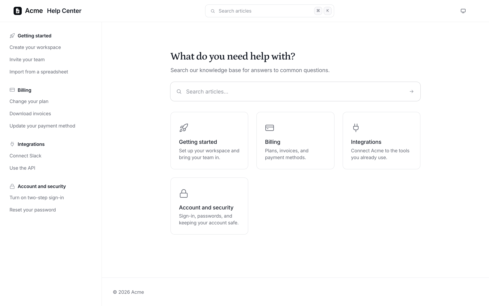
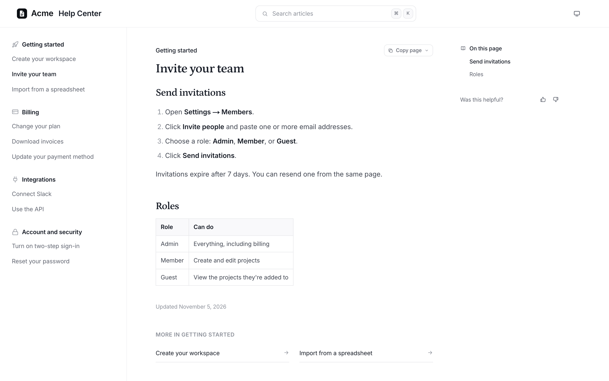
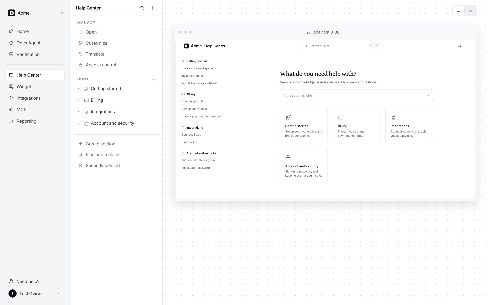

<p align="center">
  
</p>

<h1 align="center">AutoDocs</h1>

<p align="center">
  <b>A help center that keeps itself up to date.</b><br>
  When a pull request merges, an AI docs agent drafts the article changes. You review the diff and publish.
</p>

<p align="center">
  <a href="https://github.com/deanayoung3-droid/autodocs/actions/workflows/deploy.yml"></a>
  <a href="LICENSE"></a>
  <a href="https://github.com/deanayoung3-droid/autodocs/stargazers"></a>
  <a href="https://github.com/deanayoung3-droid/autodocs/commits/main"></a>
  
  
</p>

<p align="center">
  <a href="https://deanayoung3-droid.github.io/autodocs/"><b>Website</b></a> ·
  <a href="#quick-start-on-your-computer-about-5-minutes">Quick start</a> ·
  <a href="docs/self-hosting.md">Self-hosting</a> ·
  <a href="docs/first-steps.md">First steps</a>
</p>

<p align="center">
  
</p>

AutoDocs is a self-hosted help center plus an AI docs agent. When a pull request merges, the agent decides whether customers will notice, reads the code, and drafts the article changes (with fresh screenshots of your product, red boxes around the controls it describes). You review each change as a diff, edit it if you like, and publish. Nothing publishes on its own.

It's white-label: readers see your name, logo, colours, and domain. Nothing says AutoDocs unless you turn on "Powered by".

## What's in it

- **Help center** (`/help`): sections and articles, search by keyword and meaning, AI answers with cited sources and follow-up questions, article feedback, translations, dark mode, private docs (password, email links, or sign-in through your own product), `llms.txt` and Markdown copies for AI tools.
- **Widget** (`/widget.js`): one script tag adds search, AI answers, and a contact form to your product.
- **Docs agent**: drafts from merged pull requests, tasks you give it, and support signals; scheduled audits; checks articles against your code (Verification); captures screenshots of your product in a headless browser.
- **Admin** (`/admin`): editor, review queue with diffs, verification, reporting (searches with no answer, AI conversations, topics), team accounts with roles.
- **Integrations**: GitHub (a GitHub App it creates for you), Slack (`/docs` command and notifications), Linear, 13 helpdesks (Intercom, Zendesk, Help Scout, and more) for support signals, outgoing webhooks, an MCP server for Claude, ChatGPT, Cursor and other AI clients, and a Chrome extension.
- **Import**: bring an existing help center over from its `llms.txt` or sitemap, with redirects from the old addresses.

## Screenshots

<table>
  <tr>
    <td width="50%"><br><sub>An article, with a table of contents and feedback on every page.</sub></td>
    <td width="50%"><br><sub>The admin: arrange sections and see the help center as readers will.</sub></td>
  </tr>
</table>

<sub>Shown with sample content for a made-up company, Acme.</sub>

## Quick start (on your computer, about 5 minutes)

You need [Node.js 24](https://nodejs.org) or newer. Nothing else: a database is built in.

```bash
git clone https://github.com/deanayoung3-droid/autodocs.git
cd autodocs
npm install
npm run setup
npm run dev
```

`npm run setup` writes `.env.local` with fresh secrets, asks for your OpenAI API key (optional; you can add it later), and prints your **setup password**.

Open http://localhost:3000/login, leave the email empty, and sign in with the setup password. You'll name your help center and create the owner account. Then follow [docs/first-steps.md](docs/first-steps.md).

## Run it for real

| Where | How | Good for |
|---|---|---|
| Any server with Docker (a $10–20/month VPS is plenty) | [docs/self-hosting.md](docs/self-hosting.md): `npm run setup -- --docker`, then `docker compose --profile https up -d` | Most teams. Postgres and automatic HTTPS included. |
| Google Cloud (Cloud Run + Cloud SQL) | [deploy/AGENT-SETUP.md](deploy/AGENT-SETUP.md): scripts an AI agent can run for you, and every push to `main` deploys itself | Teams already on Google Cloud who want managed backups and zero-downtime deploys. |

## How it's built

- **Next.js 16** (App Router) on Node 24, **React 19**, Tailwind CSS 4.
- **PostgreSQL** for everything: content, settings, sealed credentials, the job queue, and AI search (full-text plus `pgvector` embeddings). With no `DATABASE_URL`, a built-in Postgres ([PGlite](https://pglite.dev)) runs inside the app and keeps its data in `./data`.
- **OpenAI API** for the AI features: the agent and verification on GPT-6.1 Sol, reader answers on GPT-6.1 Terra, topic grouping on GPT-6 Luna, embeddings with `text-embedding-3-small`. All configurable; Settings → AI shows usage and cost.
- **Playwright** (headless Chromium) for screenshots.
- **Background jobs** in the database, run by the same server: nothing else to deploy.

## Configuration

Everything is in [.env.example](.env.example). Only three values are required: `ADMIN_PASSWORD`, `SESSION_SECRET`, and `PUBLIC_URL`. Add `OPENAI_API_KEY` for the AI features. Integrations (GitHub, Slack, Linear, helpdesks, email delivery) are connected in the admin, and their credentials are stored sealed in the database.

## Develop

```bash
npm run dev         # http://localhost:3000
npm run lint
npm run typecheck
npm run build       # production build
```

The database schema is in `src/lib/schema.ts` as numbered migrations that run on start. See [CONTRIBUTING.md](CONTRIBUTING.md).

## Star history

<a href="https://star-history.com/#deanayoung3-droid/autodocs&Date">
  <picture>
    <source media="(prefers-color-scheme: dark)" srcset="https://api.star-history.com/svg?repos=deanayoung3-droid/autodocs&type=Date&theme=dark">
    
  </picture>
</a>

## License

[MIT](LICENSE)
